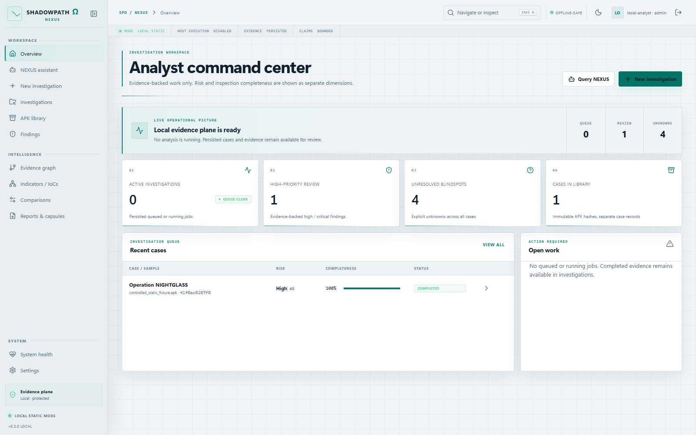
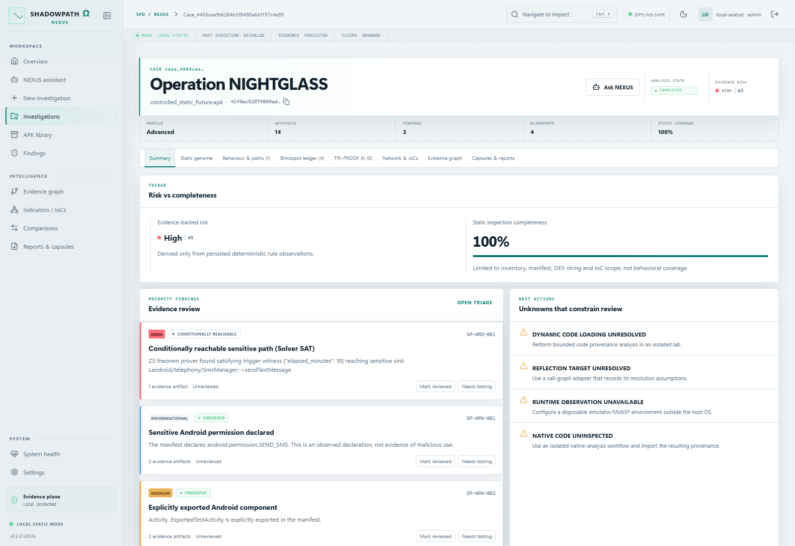
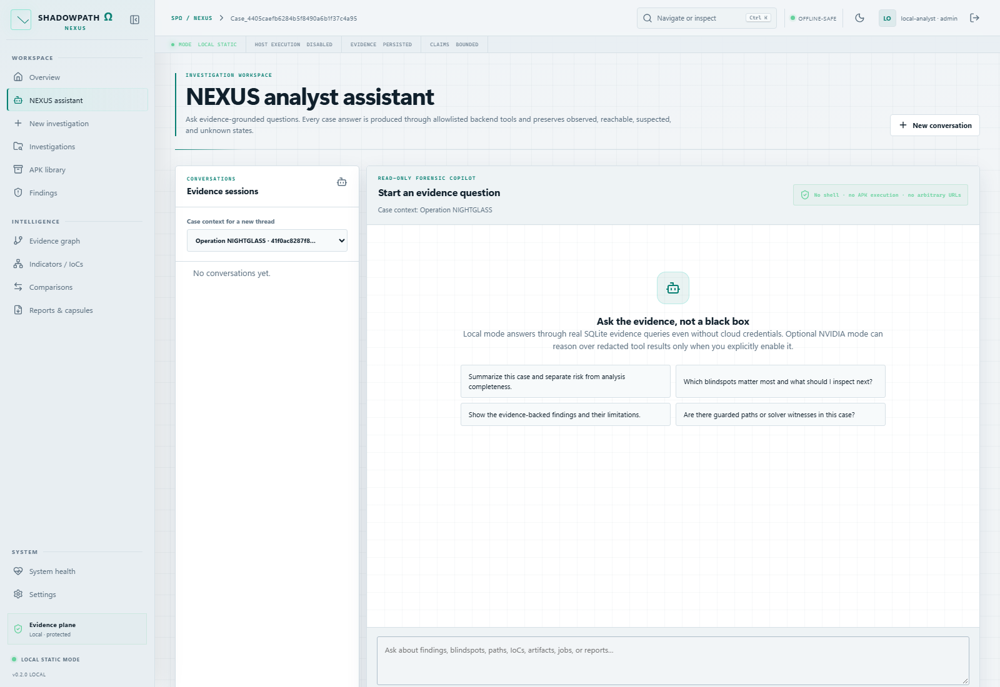
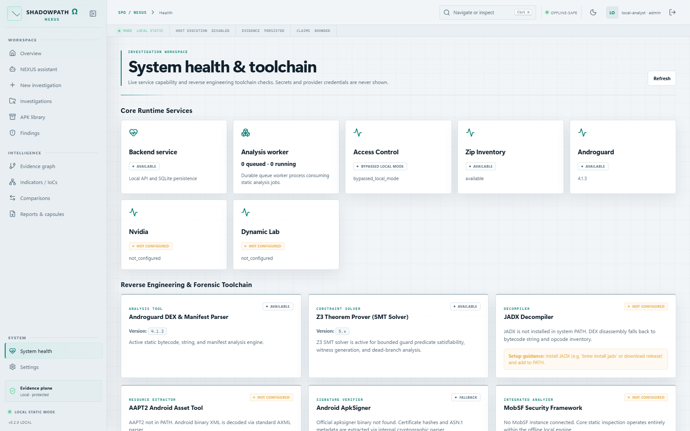
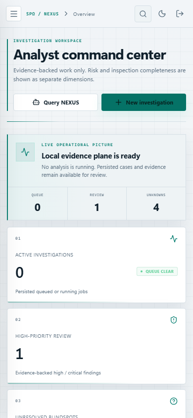
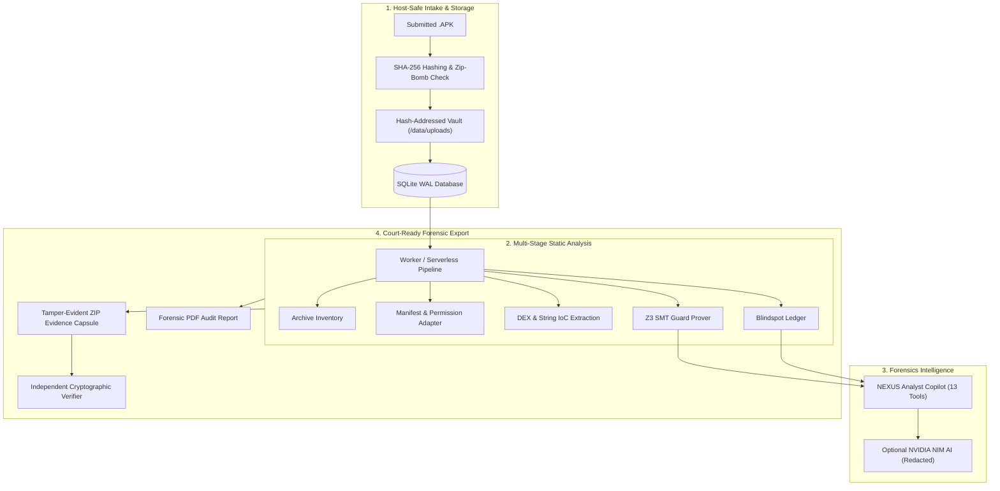

# SHADOWPATH Ω — NEXUS
### Evidence-Driven Android APK Forensic Triage & Evidence Intelligence Platform
**Developed by Team PARTH for Bihar Police Hackathon**

[](https://vercel.com)
[](https://python.org)
[](https://fastapi.tiangolo.com)
[](https://react.dev)
[](https://www.typescriptlang.org)
[](https://sqlite.org)

---

## Executive Summary

**SHADOWPATH Ω — NEXUS** is an evidence-first, defensive static-analysis and forensic triage workstation engineered specifically for law-enforcement and digital forensics investigators analyzing suspicious or malicious Android APKs.

Designed for high-throughput forensic triage without exposing investigator workstations to dynamic execution hazards, NEXUS:
1. Safely unpacks, validates, hashes (SHA-256), and catalogs APK packages against compression-bomb and path-traversal attacks.
2. Extracts manifest component topologies, sensitive permissions, DEX-shaped payloads, IoC strings, and cryptographic signing certificates.
3. Models sensitive execution branches using the **Z3 Theorem Prover (SMT)** to mathematically prove whether guarded paths are reachable or unsatisfiable dead branches.
4. Maintains an immutable **Blindspot Ledger** documenting unparsed manifests, native `.so` libraries, reflection, and out-of-budget code regions.
5. Employs the **NEXUS Analyst Assistant**—an investigation copilot featuring 13 server-side forensics tools and optional NVIDIA NIM reasoning.
6. Packages all findings, artifacts, and tamper-evident SHA-256 hash chains into verifiable **ZIP Evidence Capsules** and court-ready PDF audit reports.

> **Forensic Safety Mandate:** Host workstations are protected by design. Raw APK binaries are never dynamically executed on the analyst host.

---

## Real Application Showcase

### 1. Operations Overview & Case Dashboard
Real-time triage ledger tracking active cases, risk scores, static completeness, active worker pipelines, and critical finding distributions.


### 2. Multi-Tab Case Investigation & Evidence Triage
Deep inspection workspace: manifest topology, decompiled DEX inventory, Z3 guard evaluation, blindspots, and cryptographic certificate blobs.


### 3. NEXUS Forensics Copilot Assistant
Persistent evidence-routing assistant backed by 13 server-side tools querying real cases, IoCs, and guard branches with verified citation anchors.


### 4. Health, Adapters & Capability Matrix
Transparent telemetry verifying Z3 SMT solver status, Androguard parsers, SQLite WAL storage, and cloud AI provider configuration.


### 5. Responsive Analyst View
High-density editorial cybersecurity UI optimized across ultra-wide desktop monitors, laptops, and mobile field tablets.


---

## Architectural Blueprint



---

## Key Implemented Capabilities

| Subsystem | Implemented Capability | Law Enforcement Significance |
|---|---|---|
| **Intake Sanitization** | Streaming file validation, size enforcement, ZIP traversal rejection, decompression ratio check (120:1 max). | Eliminates zip-bomb and arbitrary host overwrite threats before parsing begins. |
| **Evidence Ledger** | Normalized findings, extracted strings, certificate fingerprints, and exported Android components. | Provides defensible, verifiable facts without fabricating intent or reachability. |
| **Z3 Theorem Prover** | SMT predicate solver checking guard conditions leading to sensitive APIs/sinks. | Determines whether hostile triggers (e.g. time bomb, device model check) are mathematically reachable. |
| **Blindspot Ledger** | Explicit accounting of native `.so` libraries, reflection, dynamic DexClassLoader, and budget cutoffs. | Guarantees investigators know what the tool *could not* verify, eliminating false confidence. |
| **Tamper-Evident Capsule** | Zip archive bundling manifest, DEX extract, reports, and SHA-256 hash manifest. | Meets chain-of-custody requirements with standalone script verification. |
| **Analyst Assistant** | 13 server-side investigative tools querying cases, blindspots, IoCs, and comparison diffs. | Enables natural language investigation while strictly forbidding unsafe shell/network execution. |
| **Dual Deployment Modes** | Fully local zero-network workstation mode OR Vercel cloud serverless deployment. | Deployable in air-gapped lab or accessible remotely by field officers. |

---

## Quickstart & Deployment

### Option A: 1-Click Vercel Deployment (Cloud Serverless)

The repository is pre-configured with root `vercel.json`, `package.json`, and `api/index.py` for immediate Vercel hosting:

1. Push this repository to GitHub (`NAYANBECS24/PARTH`).
2. Log in to [Vercel](https://vercel.com) and click **"Add New Project"**.
3. Import the `PARTH` repository.
4. **Environment Settings**:
   - Framework Preset: **Other** (or Vite)
   - Root Directory: `./`
   - Build Command: `npm run build`
   - Output Directory: `frontend/dist`
5. Click **Deploy**. Vercel will:
   - Build the React SPA frontend into `frontend/dist`.
   - Deploy `api/index.py` as Python serverless functions for `/api/*` and `/health`.
   - Seed the SQLite database in `/tmp/shadowpath_data` with sample cases and fixtures.
   - Run in demo mode (`SHADOWPATH_AUTH_DISABLED=true`) so reviewers can immediately interact with all features.

---

### Option B: Local Workstation (Windows / Linux / macOS)

#### Prerequisites
- **Node.js**: v20+ or v24+
- **Python**: 3.12+

#### 1. One-Click Launch (Windows)
Double-click `start.bat` in the project root, or execute via PowerShell:
```powershell
./scripts/dev.ps1
```
The script auto-detects dependencies, boots the FastAPI API on `http://127.0.0.1:8000`, starts the analysis pipeline, and serves the analyst UI at `http://127.0.0.1:5173`.

#### 2. Manual Terminal Launch
**Terminal 1 — Backend API & Worker:**
```bash
python -m pip install -r requirements.txt
python -m uvicorn backend.api:app --host 127.0.0.1 --port 8000
```
**Terminal 2 — Background Analysis Worker:**
```bash
python -m backend.worker
```
**Terminal 3 — Frontend React Console:**
```bash
cd frontend
npm install
npm run dev
```

---

## Safe Fixture Testing & Independent Verification

NEXUS includes safe, synthetic test APK fixtures that exercise the static pipeline without real malware risks:

### 1. Generating Safe Test Fixtures
```bash
python scripts/create_safe_fixture.py
```
Generated fixtures in `fixtures/safe-android-apps/`:
- `dead_branch.apk`: Exercises Z3 dead-code detection.
- `device_guarded_sink.apk`: Tests device model guard satisfiability.
- `manifest_misconfig.apk`: Validates exported component alerts.
- `time_guarded_sink.apk`: Tests time-delay trigger constraints.

### 2. Independent Evidence Capsule Verification
Evidence capsules generated by NEXUS contain an internal SHA-256 hash manifest. Verify any exported capsule without starting the web application:
```bash
python scripts/verify_capsule.py data/capsules/case_082b79affcf74907aa0878f2b848bc83-job_f73923ad8abb4b089817bae50bd40c81-capsule.zip
```

---

## Automated Verification Suite

Run full system verification across both Python and TypeScript components:

```bash
# Python backend & integration test suite
python -m pytest -q

# Frontend linting, type-safety, and production bundle
cd frontend
npm run lint
npm run typecheck
npm run test
npm run build
```

---

## Repository Structure

```text
├── api/
│   └── index.py                     # Vercel serverless ASGI entrypoint
├── backend/
│   ├── adapters.py                  # Androguard, Z3 SMT & system toolchain adapters
│   ├── ai_provider.py               # NVIDIA NIM provider with strict redaction
│   ├── analyzer.py                  # Core static analysis & stage pipeline
│   ├── api.py                       # FastAPI REST API endpoints
│   ├── assistant.py                 # NEXUS Copilot with 13 investigative tools
│   ├── auth.py                      # PBKDF2 authentication & audit logging
│   ├── config.py                    # Environment & serverless configuration
│   ├── database.py                  # SQLite WAL schema & transaction management
│   ├── intake.py                    # Streaming archive validation & deduplication
│   ├── reports.py                   # PDF generator & ZIP capsule builder
│   └── worker.py                    # Background job processing worker
├── data/
│   ├── capsules/                    # Pre-generated evidence capsules
│   ├── reports/                     # Pre-generated PDF & JSON reports
│   └── shadowpath.db                # Seed SQLite database with pre-analyzed cases
├── docs/
│   ├── screenshots/                 # Real application interface screenshots
│   ├── IMPLEMENTATION_STATUS.md     # Gate verification & implementation matrix
│   └── architecture-decisions.md   # ADR records & threat modeling
├── fixtures/                        # Safe synthetic Android APK fixtures
├── frontend/
│   ├── src/                         # React 18 + TypeScript + Tailwind CSS UI
│   ├── package.json                 # Frontend dependencies
│   └── vite.config.ts               # Vite configuration
├── package.json                     # Root npm script runner for Vercel
├── requirements.txt                 # Python dependencies for Vercel & local
├── start.bat                        # Windows 1-click startup batch script
└── vercel.json                      # Vercel deployment & rewrite routing rules
```

---

## Accreditation & Team PARTH

Developed with rigor for the **Bihar Police Hackathon** by **Team PARTH**.

- **Lead Engineer & Architect**: Nayan Kumar
- **Domain Focus**: Android APK Reverse Engineering, SMT Guard Analysis, Evidentiary Triage
- **Status**: Vercel Ready & Verified Clean
